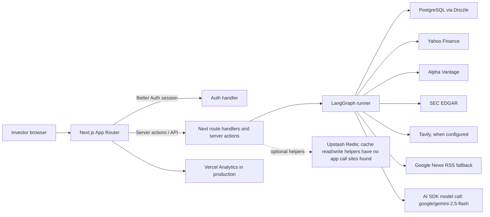
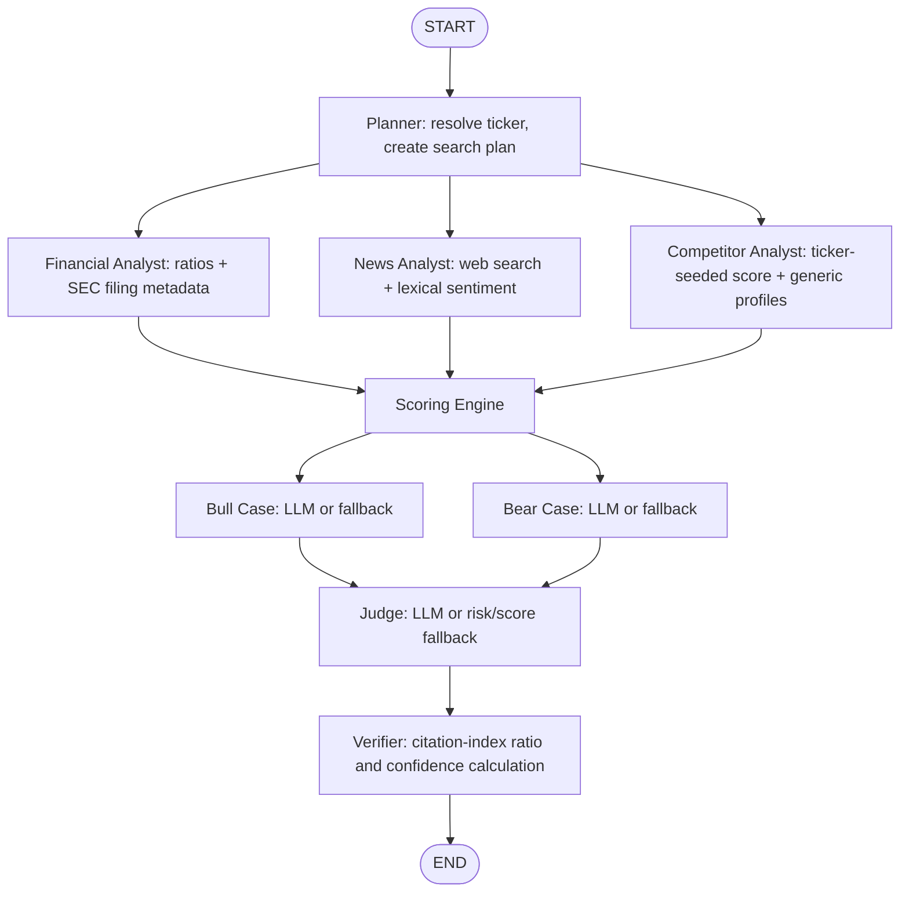

# InvestIQ Architecture and Dataflow

**Audit date:** 2026-11-15. All diagrams describe source-observed wiring; provider responses and deployed infrastructure were not available for verification.

## System Context



## Single-Company Request Sequence

```mermaid
sequenceDiagram
  actor User
  participant UI as Next.js UI
  participant Actions as Server actions
  participant DB as PostgreSQL/Drizzle
  participant Stream as /api/analysis/stream
  participant Runner as lib/agent/runner
  participant Graph as LangGraph
  participant Providers as Yahoo/AV/SEC/Search/LLM

  User->>UI: Search/select ticker
  UI->>UI: GET /api/search/companies (fixed local catalog)
  User->>UI: Start analysis
  UI->>Actions: createOrUpdateCompany(ticker)
  Actions->>DB: user-scoped upsert
  UI->>Actions: createAnalysis(companyId,ticker)
  Actions->>DB: transaction, quota check, insert pending record
  UI->>UI: Navigate to /analysis/[id]
  UI->>Actions: load analysis and agent rows
  UI->>Stream: POST ticker, identity context, analysisId
  Stream->>Stream: session check, in-process rate limit, optional DB status/quota checks
  Stream->>Runner: streamAnalysis(input)
  Runner->>Graph: stream updates and values
  Graph->>Providers: planner resolves ticker; research nodes fetch data
  Graph->>Graph: scoring -> parallel bull/bear -> judge -> verifier
  Graph-->>Runner: thought/agent/complete/error events
  Runner-->>Stream: SSE event stream
  Stream->>Actions: persistAnalysisResults on final state
  Actions->>DB: transactionally update analysis and replace agent rows
  Stream-->>UI: SSE events and [DONE]
  UI->>UI: render verdict, scores, arguments, export controls
```

### Important branch behavior

- `app/analysis/[id]/page.tsx` checks the session and user-scoped record. `pending` and `processing` records render `StreamingAnalysis` with `autoStart`.
- `components/analyze-form.tsx` performs company upsert and pending analysis creation before navigation.
- `app/api/analysis/stream/route.ts` uses `streamAnalysis` from the active runner. The imported `AnalysisService` is unused.
- `lib/agents/orchestrator.ts` is a thin compatibility re-export of `lib/agent/runner.ts`; it is not a second implementation.
- The graph has no checkpoint saver. State is in memory for the request; database persistence happens after the graph emits a complete event.
- A stream error is sent to the browser but the route does not update the row to `failed`. A disconnected browser has no graph cancellation path visible in the inspected code.

## Agent Graph


The research fan-out and bull/bear branches run in parallel graph supersteps. The LLM wrapper is used by planner, bull, bear and judge only. The news and competitor prompts exist in `lib/agent/prompts/index.ts` but their active nodes do not make those LLM calls. The verifier is deterministic despite its wording and UI positioning.

## Agent Contracts and Prompt Use

The system prompts are implemented in `lib/agent/prompts/index.ts`; structured outputs are defined in `lib/agent/schemas/index.ts`. All active model calls use `google/gemini-2.5-flash`, temperature 0.3, a 20-second abort signal and `maxRetries: 2` through `callStructuredLLM`. It truncates prompt text to three times each agent's input-token budget. Exact provider credential routing was not tested.

| Node | Input -> output | Prompt/model | Tools and failure behavior | Downstream use |
|---|---|---|---|---|
| Planner | Current ticker/name -> resolved ticker/sector, research plan, search queries | `plannerPrompt`: institutional-style planner, JSON plan; LLM budget 4000 input/1500 output | `resolveTicker` tries local directory, Yahoo, Alpha Vantage, optional LLM and permissive ticker-pattern fallback; structured-call failure returns deterministic plan | Sets graph ticker/sector and search queries |
| Financial Analyst | Ticker -> five nullable metrics, SEC filing metadata, citations | No active LLM prompt | Alpha Vantage then Yahoo; SEC EDGAR search; catches provider failures and may leave initial nulls/quality state | Metrics feed score and bull/bear context |
| News Analyst | First planner query -> articles, keyword sentiment, citations | `newsPrompt` exists but is not called | Tavily then Google News RSS; empty/error path returns neutral 50 and may continue as normal | News sentiment enters score/context |
| Competitor Analyst | Sector/ticker/search query -> competitor profiles and score | `competitorPrompt` exists but is not called | Search title is optional; score is ticker-seeded and profiles are generic | Competition score/labels enter scoring and argument context |
| Scoring Engine | Financial/news/competitor inputs -> score breakdown and source list | No LLM; local deterministic formulas | Does not throw on ordinary missing values; missingness penalty applies | Score dimensions feed arguments and judge |
| Bull Case | Summarized metrics/scores/articles/competitors -> 3-5 structured points, specificity and confidence | `bullPrompt`: exactly-five instruction, concrete context, `[source:N]`; schema accepts 3-5; LLM budget 12000/2000 | `callStructuredLLM`; deterministic metric-based fallback, source index 0 when no signal | Used by judge and UI; source indices are not validated against actual source text |
| Bear Case | Same context -> 3-5 risks, severity and confidence | `bearPrompt`: exactly-five instruction, risk-focused context and source tags; schema accepts 3-5; budget 12000/2000 | LLM with fallback to explicit debt/growth/sentiment/risk conditions | Used by judge and UI; source indices are not entailment-checked |
| Judge | Bull/bear point strings, composite score and risk tolerance -> verdict, confidence, reasoning, point indexes | `judgePrompt` asks for qualitative synthesis and permits overriding composite; schema verdict enum BUY/HOLD/PASS; budget 16000/2000 | LLM result or deterministic risk threshold fallback; current post-processing caps BUY using score verdict and `dataQualityScore` | Final verdict/reasoning; post-processing cannot fix unsupported source claims |
| Verifier | Bull/bear points, numeric score dimensions, citations -> grounding ratio, uncited strings and confidence | `verifierPrompt` exists but is not called; no LLM | Counts positive source indexes; estimates evidence quality from citation count; no retrieval or factual comparison | Overwrites confidence and sets `uncitedClaims`; does not revise verdict |

Planner, bull, bear and judge have no persisted prompt/token/cost usage in current analysis writes (`prompt`, `tokenUsage`, `cost` are null in `persistAnalysisResults`). UI agent labels and static copy sometimes call the nodes "AI agents" even when they are deterministic.

## Data Origin and Transformations

| Data | Origin | Transformation/validation | Destination and known gap |
|---|---|---|---|
| Ticker/name/sector | 26-item local catalog; Yahoo search; Alpha Vantage symbol search; optional planner LLM; permissive ticker-pattern fallback | `sanitizeCompanyInput` and `sanitizeTicker`; Zod planner output | Graph state and per-user company row. Alpha Vantage search maps region/currency fields into `sector`, so that field is semantically wrong. Unknown valid-looking symbols may be accepted without verification. |
| Fundamentals | Alpha Vantage `OVERVIEW`, then Yahoo `quoteSummary` | Parses PE, YoY revenue growth, debt/equity, gross margin, FCF yield into five nullable values | `FinancialMetrics`; no normalized statements/periods/currency/fetched-at record. A manual/unavailable fallback returns nulls. |
| Filing evidence | SEC EDGAR full-text search endpoint by ticker string | Takes up to three search hits and uses type/date/URL summary | Citations and agent source URLs; filing body is not retrieved or parsed into facts. |
| News | Tavily if configured; otherwise Google News RSS search | RSS XML regex extraction; Google result content is replaced with a generic query string; title/content keywords give sentiment; recency and relevance weights applied | `newsArticles`, score and citations. No article-body validation, source ranking, conflict reconciliation, or stale-news exclusion. |
| Competitors | Same search helper | Only first search title is retained as a signal; profiles and scores are generated from ticker character-code seed and generic labels | `competitorData` and `competitionScore`; score is not derived from measured competitors/market share. |
| LLM output | AI SDK `generateObject`, configured with `google/gemini-2.5-flash` | Zod schemas, temperature 0.3, 20s abort timeout, maxRetries 2, fallback on any exception | Planner, bull, bear and judge state. Actual model gateway/auth resolution is not integration-tested. |
| Scores | Internal fixed formulas | Clamped 0-100 and weighted composite | Explainability panel and verdict gate. No calibration set, sector normalization or outcome labels. |
| Citations | Filing/news arrays returned by parallel nodes | Nodes derive indexes from their pre-merge `state.citations.length` | Parallel nodes can produce colliding indexes. Verifier counts `sourceIndex > 0`, not whether index exists or supports claim. |
| Final result | LangGraph state | Runner maps confidence to 0-1, strings bull/bear points, maps uncited claims to `hallucinations` | SSE client and database. `hallucinations` actually means uncited-claim strings, not detected factual hallucinations. |

## Scoring and Verdict Flow

`lib/agent/scoring.ts` computes five metrics. Each financial ratio is first converted by a hand-coded piecewise function. Five ratio scores are equally averaged; missing metrics subtract 7 points each, capped at 25. `buildScoreBreakdown` then computes market, sentiment, competition and risk heuristics, applies an additional missing-data penalty, combines weights (financial 30%, market 20%, sentiment 15%, competition 15%, risk 20%), and subtracts the penalty from the composite.

`applyRiskTolerance` uses BUY/HOLD thresholds: conservative 80/60, moderate 70/45, aggressive 55/35. `judgeNode` reduces its input score for low `dataQualityScore` and gates any LLM BUY against the score-based verdict and a quality minimum. However, the financial node sets `dataQualityScore` based on the `stale` boolean rather than provider `dataQuality`/missing-metric count; initial state defaults quality to 1. Therefore partial data can remain high-quality from the judge's perspective. The verifier subsequently recalculates confidence and floors it at 25, but does not reconsider verdict.

The verifier's base confidence formula uses a different ordering of market/sentiment weights from the composite scorer, applies score-dispersion and citation-count multipliers, and clamps to 25-82. This is not a calibrated probability of an investment outcome.

## Persistence and Ownership

- `companies` and `analyses` have `userId`; queries in `app/actions/analyses.ts` and `companies.ts` filter by authenticated user.
- `createAnalysis` and `persistAnalysisResults` use Drizzle transactions. Persistence updates the analysis and deletes/reinserts agent rows.
- `analysisId` lookup in the streaming route includes user id when checking existing status. Route handling of missing/processing IDs is not strict and the branch can bypass quota checks.
- A `sources` table exists but no insertion path was found; citations are serialized into the analysis record's JSON fields instead.
- Portfolio, watchlist, holdings and backtest schema tables have no application workflow found.
- `runMigrations()` expects `lib/db/migrations`; no migration files/directory were found in this workspace.

## Caching and Rate Limits

| Mechanism | Implementation | Scope/limitations |
|---|---|---|
| Research data cache | `cached()` Map in `lib/agent/tools/http.ts`, 10-minute TTL | Process-local, non-distributed, no in-flight request coalescing, failures not cached |
| DB status cache | `lib/db/connection-cache.js`, 5-second TTL | Process-local; reduces repeat probes only |
| Redis helpers | `lib/cache.ts` with Upstash | `isCacheEnabled()` is used by health route; generic analysis-cache GET/SET/DEL functions have no app caller found |
| Rate limiting | `lib/rate-limit.ts` Map sliding window | Process-local; serverless/multi-instance deployments can bypass aggregate limits; stream and compare use it, search/support/auth are not similarly limited in app code |

## Error Handling and Recovery

- Provider tools generally catch errors and return empty or partial data, allowing graph continuation. This improves availability but can make a weak-evidence report appear complete.
- LLM errors, missing credentials, timeout, malformed schema and provider errors all route to fallback values in `callStructuredLLM`; callers often cannot distinguish model-generated output from fallback in the final display.
- Financial/news/competitor nodes record some errors; not all result paths set a consistent degraded status or data quality value.
- The SSE endpoint catches graph errors and emits an `error` event, then closes the stream. It does not mark the persisted analysis failed or resume from checkpoint.
- The client sets status to complete after the stream read loop even if an error event set an error state during the loop. Retrying can repeat a request without idempotency.

## Comparison Flow

`CompareClient` POSTs two selected symbols to `/api/analysis/compare`. The route authenticates and rate-limits, sanitizes ticker strings, resolves names from the local catalog (unknown tickers become name=ticker/sector=Unknown), attempts to create records, runs two full graphs in parallel using `Promise.allSettled`, and returns both results. Persistence failures are swallowed. Persisted comparisons use `skipQuotaIncrement: true`; there is no payment provider or comparison-specific usage accounting. The UI shows verdicts, score dimensions and debate data. It invents no separate peer benchmark and is not a statistical comparative valuation.
# InvestIQ Architecture and Dataflow

**Audit date:** 2026-11-15. All diagrams describe source-observed wiring; provider responses and deployed infrastructure were not available for verification.

## System Context


## Single-Company Request Sequence

```mermaid
sequenceDiagram
  actor User
  participant UI as Next.js UI
  participant Actions as Server actions
  participant DB as PostgreSQL/Drizzle
  participant Stream as /api/analysis/stream
  participant Runner as lib/agent/runner
  participant Graph as LangGraph
  participant Providers as Yahoo/AV/SEC/Search/LLM

  User->>UI: Search/select ticker
  UI->>UI: GET /api/search/companies (fixed local catalog)
  User->>UI: Start analysis
  UI->>Actions: createOrUpdateCompany(ticker)
  Actions->>DB: user-scoped upsert
  UI->>Actions: createAnalysis(companyId,ticker)
  Actions->>DB: transaction, quota check, insert pending record
  UI->>UI: Navigate to /analysis/[id]
  UI->>Actions: load analysis and agent rows
  UI->>Stream: POST ticker, identity context, analysisId
  Stream->>Stream: session check, in-process rate limit, optional DB status/quota checks
  Stream->>Runner: streamAnalysis(input)
  Runner->>Graph: stream updates and values
  Graph->>Providers: planner resolves ticker; research nodes fetch data
  Graph->>Graph: scoring -> parallel bull/bear -> judge -> verifier
  Graph-->>Runner: thought/agent/complete/error events
  Runner-->>Stream: SSE event stream
  Stream->>Actions: persistAnalysisResults on final state
  Actions->>DB: transactionally update analysis and replace agent rows
  Stream-->>UI: SSE events and [DONE]
  UI->>UI: render verdict, scores, arguments, export controls
```

### Important branch behavior

- `app/analysis/[id]/page.tsx` checks the session and user-scoped record. `pending` and `processing` records render `StreamingAnalysis` with `autoStart`.
- `components/analyze-form.tsx` performs company upsert and pending analysis creation before navigation.
- `app/api/analysis/stream/route.ts` uses `streamAnalysis` from the active runner. The imported `AnalysisService` is unused.
- `lib/agents/orchestrator.ts` is a thin compatibility re-export of `lib/agent/runner.ts`; it is not a second implementation.
- The graph has no checkpoint saver. State is in memory for the request; database persistence happens after the graph emits a complete event.
- A stream error is sent to the browser but the route does not update the row to `failed`. A disconnected browser has no graph cancellation path visible in the inspected code.

## Agent Graph



The research fan-out and bull/bear branches run in parallel graph supersteps. The LLM wrapper is used by planner, bull, bear and judge only. The news and competitor prompts exist in `lib/agent/prompts/index.ts` but their active nodes do not make those LLM calls. The verifier is deterministic despite its wording and UI positioning.

## Data Origin and Transformations

| Data | Origin | Transformation/validation | Destination and known gap |
|---|---|---|---|
| Ticker/name/sector | 26-item local catalog; Yahoo search; Alpha Vantage symbol search; optional planner LLM; permissive ticker-pattern fallback | `sanitizeCompanyInput` and `sanitizeTicker`; Zod planner output | Graph state and per-user company row. Alpha Vantage search maps region/currency fields into `sector`, so that field is semantically wrong. Unknown valid-looking symbols may be accepted without verification. |
| Fundamentals | Alpha Vantage `OVERVIEW`, then Yahoo `quoteSummary` | Parses PE, YoY revenue growth, debt/equity, gross margin, FCF yield into five nullable values | `FinancialMetrics`; no normalized statements/periods/currency/fetched-at record. A manual/unavailable fallback returns nulls. |
| Filing evidence | SEC EDGAR full-text search endpoint by ticker string | Takes up to three search hits and uses type/date/URL summary | Citations and agent source URLs; filing body is not retrieved or parsed into facts. |
| News | Tavily if configured; otherwise Google News RSS search | RSS XML regex extraction; Google result content is replaced with a generic query string; title/content keywords give sentiment; recency and relevance weights applied | `newsArticles`, score and citations. No article-body validation, source ranking, conflict reconciliation, or stale-news exclusion. |
| Competitors | Same search helper | Only first search title is retained as a signal; profiles and scores are generated from ticker character-code seed and generic labels | `competitorData` and `competitionScore`; score is not derived from measured competitors/market share. |
| LLM output | AI SDK `generateObject`, configured with `google/gemini-2.5-flash` | Zod schemas, temperature 0.3, 20s abort timeout, maxRetries 2, fallback on any exception | Planner, bull, bear and judge state. Actual model gateway/auth resolution is not integration-tested. |
| Scores | Internal fixed formulas | Clamped 0-100 and weighted composite | Explainability panel and verdict gate. No calibration set, sector normalization or outcome labels. |
| Citations | Filing/news arrays returned by parallel nodes | Nodes derive indexes from their pre-merge `state.citations.length` | Parallel nodes can produce colliding indexes. Verifier counts `sourceIndex > 0`, not whether index exists or supports claim. |
| Final result | LangGraph state | Runner maps confidence to 0-1, strings bull/bear points, maps uncited claims to `hallucinations` | SSE client and database. `hallucinations` actually means uncited-claim strings, not detected factual hallucinations. |

## Scoring and Verdict Flow

`lib/agent/scoring.ts` computes five metrics. Each financial ratio is first converted by a hand-coded piecewise function. Five ratio scores are equally averaged; missing metrics subtract 7 points each, capped at 25. `buildScoreBreakdown` then computes market, sentiment, competition and risk heuristics, applies an additional missing-data penalty, combines weights (financial 30%, market 20%, sentiment 15%, competition 15%, risk 20%), and subtracts the penalty from the composite.

`applyRiskTolerance` uses BUY/HOLD thresholds: conservative 80/60, moderate 70/45, aggressive 55/35. `judgeNode` reduces its input score for low `dataQualityScore` and gates any LLM BUY against the score-based verdict and a quality minimum. However, the financial node sets `dataQualityScore` based on the `stale` boolean rather than provider `dataQuality`/missing-metric count; initial state defaults quality to 1. Therefore partial data can remain high-quality from the judge's perspective. The verifier subsequently recalculates confidence and floors it at 25, but does not reconsider verdict.

The verifier's base confidence formula uses a different ordering of market/sentiment weights from the composite scorer, applies score-dispersion and citation-count multipliers, and clamps to 25-82. This is not a calibrated probability of an investment outcome.

## Persistence and Ownership

- `companies` and `analyses` have `userId`; queries in `app/actions/analyses.ts` and `companies.ts` filter by authenticated user.
- `createAnalysis` and `persistAnalysisResults` use Drizzle transactions. Persistence updates the analysis and deletes/reinserts agent rows.
- `analysisId` lookup in the streaming route includes user id when checking existing status. Route handling of missing/processing IDs is not strict and the branch can bypass quota checks.
- A `sources` table exists but no insertion path was found; citations are serialized into the analysis record's JSON fields instead.
- Portfolio, watchlist, holdings and backtest schema tables have no application workflow found.
- `runMigrations()` expects `lib/db/migrations`; no migration files/directory were found in this workspace.

## Caching and Rate Limits

| Mechanism | Implementation | Scope/limitations |
|---|---|---|
| Research data cache | `cached()` Map in `lib/agent/tools/http.ts`, 10-minute TTL | Process-local, non-distributed, no in-flight request coalescing, failures not cached |
| DB status cache | `lib/db/connection-cache.js`, 5-second TTL | Process-local; reduces repeat probes only |
| Redis helpers | `lib/cache.ts` with Upstash | `isCacheEnabled()` is used by health route; generic analysis-cache GET/SET/DEL functions have no app caller found |
| Rate limiting | `lib/rate-limit.ts` Map sliding window | Process-local; serverless/multi-instance deployments can bypass aggregate limits; stream and compare use it, search/support/auth are not similarly limited in app code |

## Error Handling and Recovery

- Provider tools generally catch errors and return empty or partial data, allowing graph continuation. This improves availability but can make a weak-evidence report appear complete.
- LLM errors, missing credentials, timeout, malformed schema and provider errors all route to fallback values in `callStructuredLLM`; callers often cannot distinguish model-generated output from fallback in the final display.
- Financial/news/competitor nodes record some errors; not all result paths set a consistent degraded status or data quality value.
- The SSE endpoint catches graph errors and emits an `error` event, then closes the stream. It does not mark the persisted analysis failed or resume from checkpoint.
- The client sets status to complete after the stream read loop even if an error event set an error state during the loop. Retrying can repeat a request without idempotency.

## Comparison Flow

`CompareClient` POSTs two selected symbols to `/api/analysis/compare`. The route authenticates and rate-limits, sanitizes ticker strings, resolves names from the local catalog (unknown tickers become name=ticker/sector=Unknown), attempts to create records, runs two full graphs in parallel using `Promise.allSettled`, and returns both results. Persistence failures are swallowed. Persisted comparisons use `skipQuotaIncrement: true`; there is no payment provider or comparison-specific usage accounting. The UI shows verdicts, score dimensions and debate data. It invents no separate peer benchmark and is not a statistical comparative valuation.
